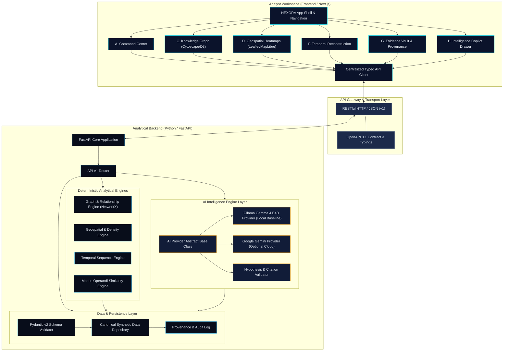

# NEXORA System Architecture Blueprint

> **Tagline:** *Every Connection Reveals a Clue.*  
> **Core Principle:** *EVIDENCE IS THE SOURCE OF TRUTH. AI GENERATES INVESTIGATIVE LEADS. THE ANALYST MAKES THE DECISION.*

---

## 1. Executive Summary

**NEXORA** is an AI-assisted evidence intelligence and relationship analysis platform engineered for law enforcement, investigative, forensic, and analytical workflows. It allows analysts to explore interconnected synthetic cases, incidents, entities, locations, timelines, and evidence through a unified, evidence-first workspace.

The platform is architected around a strict principle: **Evidence is the single source of truth**. AI systems (such as local Gemma 4 E4B or optional Google Gemini) serve strictly as assistive reasoning engines to surface investigative hypotheses and pattern candidates; they never synthesize unsubstantiated facts, modify truth states, or infer culpability.

---

## 2. High-Level Architecture Diagram



---

## 3. Monorepo Organization

NEXORA adopts a lightweight, modular monorepo structure to ensure end-to-end type safety, synchronous API contract updates, and low operational overhead:

```text
nexora-intelligence-platform/
├── frontend/             # Next.js App Router, React, TypeScript, Tailwind CSS
│   ├── src/
│   │   ├── app/          # Route segments & layouts
│   │   ├── components/   # Reusable UI & analytical widgets
│   │   ├── features/     # Feature-specific modules (command-center, cases, graph, etc.)
│   │   ├── lib/          # Centralized API client & utilities
│   │   └── types/        # Client-side domain types (synced with shared)
│   ├── public/           # Static assets & brand marks
│   ├── package.json
│   └── tsconfig.json
├── backend/              # Python FastAPI, Pydantic, Analytical Engines
│   ├── app/
│   │   ├── api/v1/       # Versioned endpoint routers
│   │   ├── core/         # Settings, logging, lifecycle
│   │   ├── schemas/      # Pydantic v2 domain schemas (Cases, Entities, Evidence)
│   │   ├── services/     # Business logic & AI abstractions
│   │   ├── analytics/    # Deterministic graph, MO, spatial, temporal logic
│   │   └── data/         # Canonical synthetic datasets & repository layer
│   ├── tests/            # Pytest test suite (health, schemas, analytics)
│   ├── pyproject.toml    # Python package & dependency manifest
│   └── requirements.txt  # Pinned backend dependencies
├── shared/               # Cross-boundary contracts & definitions
│   ├── contracts/        # OpenAPI schema definitions & exports
│   └── types/            # Canonical TypeScript type definitions
├── docs/                 # Architectural decision records & blueprints
├── .env.example          # Environment variable documentation
├── .gitignore            # Git exclusion rules
└── README.md             # Project master overview & onboarding
```

---

## 4. Frontend Architecture & Responsibilities

1. **Analytical Presentation:**
   - Next.js (App Router) provides server-side rendering where beneficial, coupled with client-side interactive visual canvases (Cytoscape/D3 for graph views, MapLibre/Leaflet for geospatial analysis).
   - High information density designed for investigative clarity: avoids empty decorative space while preventing cognitive overload.

2. **State Management & Cross-Module Context:**
   - Centralized analytical workspace context: a selected case (`currentCaseId`) or entity (`selectedEntityId`) dynamically propagates across the Knowledge Graph, Timeline, Map, and Intelligence Copilot.

3. **API Consumption:**
   - Centralized typed HTTP client with interceptors, standardized error handling, and offline/degraded mode resilience.
   - Frontend never connects directly to AI APIs or external databases.

---

## 5. Backend Architecture & Responsibilities

1. **API & Validation Layer:**
   - FastAPI provides high-performance asynchronous request handling.
   - Pydantic v2 enforces strict validation across request bodies, query parameters, synthetic data fixtures, and response payloads.

2. **Deterministic Analytical Engines:**
   - **Graph Engine:** Network topology, centrality, shortest path, and community detection using NetworkX.
   - **Spatial Engine:** Coordinate projection, bounding-box queries, and density cluster calculation.
   - **Temporal Engine:** Chronological sequencing, event interval alignment, and gap detection.
   - **MO Analysis Engine:** Explainable feature-vector comparison and weighted attribute similarity scoring (no black-box scoring).

3. **Data Ownership & Canonical Truth:**
   - All synthetic facts (cases, incidents, entities, locations, evidence records) originate from and are validated by the backend.
   - The frontend never invents or hardcodes separate factual datasets.

---

## 6. AI Provider Strategy & Boundary Isolation

1. **Provider Independence:**
   - A unified `BaseAIProvider` protocol defines operations: `generate_hypotheses`, `summarize_case`, `detect_contradictions`, `answer_query`.
   - **Local Open-Weight Model (Default):** Gemma 4 E4B hosted via Ollama (`gemma4`). Runs offline, preserves data sovereignty.
   - **Hosted Model (Optional):** Google Gemini API via official SDK, activated only by explicit configuration (`AI_PROVIDER=gemini`).

2. **Strict Non-Fallback Rule:**
   - The platform will **never** silently fall back from local Gemma to a hosted cloud API. If Ollama is unavailable, the system explicitly reports local AI downtime. Cloud APIs are strictly opt-in.

3. **Provenance & Citation Verification:**
   - Every AI response must cite explicit synthetic evidence IDs (e.g., `EVD-004`).
   - The backend validates all citations against the canonical store before forwarding responses to the frontend. Unsubstantiated claims are flagged with cautionary amber warnings.

---

## 7. Error Handling & Analytical Integrity

- Standardized RFC 7807 problem details for HTTP errors.
- Clear distinction between system errors (e.g., network failure, service offline) and analytical uncertainties (e.g., conflicting witness statements, incomplete timeline data).
- Deterministic computations are strictly separated from heuristic AI inferences.
