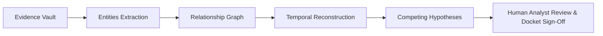

# NEXORA UX Architecture & Investigative Workflows

> **Phase:** 2 of 12 — Product Design & UX Architecture  
> **Core Doctrine:**  
> *"EVIDENCE IS THE SOURCE OF TRUTH. AI GENERATES INVESTIGATIVE LEADS. THE ANALYST MAKES THE DECISION."*  
> **Repository:** `https://github.com/Siddharth9520/nexora-intelligence-platform`

---

## 1. Executive Summary & Product Vision

NEXORA is a high-density, evidence-first intelligence analysis workstation designed to organize fragmented, multi-modal incident data into structured investigative workflows. It rejects decorative dashboard tropes in favor of an audit-grade investigative environment.

### The Canonical Workflow:


1. **Evidence Vault:** Cryptographically notarized files with SHA-256 seals and immutable chain of custody.
2. **Entities:** Structured dossiers for suspects, corporate entities, facilities, and sensor assets.
3. **Relationships:** Interactive topological knowledge graphs showing documented, inferred, and unverified associations.
4. **Patterns & Timelines:** Temporal multi-track feeds establishing strict chronological sequences.
5. **Hypotheses (ACH):** Heuer matrix systematically weighing evidence consistency against competing explanations.
6. **Human Review:** Analyst retains final sign-off authority; AI never auto-commits facts or conclusions.

---

## 2. Global Information Architecture & Navigation Shell

NEXORA enforces **one continuous application shell** across all modules.

### 2.1 Navigation Structure

```
NEXORA Workstation Shell
├── Persistent Left Sidebar (240px expanded / 64px collapsed)
│   ├── Brand Inset (Hex Emblem + Wordmark)
│   ├── + Ingest Artifact CTA
│   ├── [ANALYZE]
│   │   ├── Command Center (Flagship Hub)
│   │   ├── Cases (Case Management & Dossiers)
│   │   ├── Knowledge Graph (Topological Canvas)
│   │   └── Map (Tactical Geospatial Placement)
│   ├── [EVIDENCE]
│   │   ├── Evidence Vault (Forensic Ledger)
│   │   └── Timeline (Temporal Reconstruction)
│   ├── [REASON]
│   │   ├── AI Copilot (Contextual Assistant)
│   │   └── Hypotheses (Heuer ACH Matrix)
│   └── [PREFERENCES]
│       ├── Settings (Engine & System Config)
│       └── Help / Documentation
│
├── Persistent Top Command Bar (52px)
│   ├── Contextual Breadcrumbs
│   ├── Global Command Palette Search (Cmd+K)
│   ├── Backend Telemetry Badge (FastAPI :8000)
│   ├── Inference Engine Badge (Ollama Gemma 4 E4B / Gemini API)
│   ├── Security Compartment Tag (IL-5 AUDITED)
│   └── Authenticated Analyst Profile (Agent K. Vance)
│
├── Central Analytical Workspace
│   └── (Dynamic Canvas per Module)
│
└── Right Context Inspector (380px)
    ├── Default: "No selection" state
    └── Contextual Dossier per selected Node, Event, Case, or Evidence Item
```

---

## 3. Module-by-Module UX Specifications

### 3.1 Command Center (The Flagship Hub)
- **Hero Banner:** *"Every connection reveals a clue."* Direct CTAs: `Open Cases` and `Explore Platform`.
- **Epistemological Trust Cards:** Three compact cards explaining Documented Fact (Cyan), Analytical Result (Ice Blue), and AI Investigative Lead (Amber).
- **Module Grid:** 8 interactive cards for all platform capabilities with truthful implementation badges.
- **Workflow Stepper:** 5-step investigative progression (Evidence → Entities → Relationships → Hypotheses → Analyst Decision).
- **Truthful System Health:** Live latency check against `:8000/api/v1/health`. No fake 99.99% uptime counters.

---

### 3.2 Case Management & Detail Workspace (`CASE-001`)
- **Master List:** High-density case table with filters (Status, Priority), keyword search, and pagination.
- **Master-Detail Pivot:** Selecting a row updates the Right Context Inspector with case summary and evidence count.
- **Dedicated Case Detail Tabs:**
  1. `Overview`: Incident briefing, priority badge, and recent audit activity.
  2. `Evidence (4)`: Tabular view of attached files with SHA-256 seals.
  3. `Entities (4)`: Suspects, organizations, infrastructure targets.
  4. `Graph`: Pre-filtered case subgraph.
  5. `Timeline (6)`: Chronological event stream for the case.
  6. `Hypotheses (3)`: Evaluated ACH narratives.
  7. `Activity`: Cryptographic audit log entries.

---

### 3.3 Knowledge Graph Canvas (Signature Visual Experience)
- **Spacious Central Viewport:** 70%+ of desktop real estate dedicated to node-link topology.
- **Distinction of Edges:**
  - Solid Cyan Line: Documented connection (e.g., contractual employment, physical badge entry).
  - Dashed Amber Line: AI-inferred association (e.g., RF proximity correlation).
- **Selection Ergonomics:**
  - Clicking a node dims non-connected nodes to 25% opacity.
  - Active node receives a glowing double purple selection ring.
  - Right Context Inspector immediately renders the Entity Dossier, verified IDs, and linked evidence items.

---

### 3.4 Evidence Vault & Chain-of-Custody Ledger
- **Forensic Table:** Columns for Evidence ID, Type, Source Asset, Ingest Timestamp, Custody Chain, and SHA-256 Hash.
- **Cryptographic Notarization:** Each row displays a truncated hash (`7f83b165...9069`) with one-click full hash copy.
- **Inspector Detail:** Forensic preview, hex viewer excerpt, custody log transitions, and integrity validation check.
- **Air-Gapped Ingestion:** Explicit toggle to prevent any cloud transmission of forensic artifacts.

---

### 3.5 Timeline Reconstruction
- **Multi-Track Chronological Feed:** Linear event cards ordered by atomic UTC timestamps.
- **Temporal Scrubber:** Date range picker with slider (`2026-10-12` to `2026-10-18`).
- **Semantic Classification Pips:**
  - Cyan: Direct sensor or physical access fact (`EVT-004`).
  - Ice Blue: Analytical inference from telemetry logs (`EVT-001`).
  - Amber: AI-generated lead requiring verification (`EVT-003`).

---

### 3.6 AI Copilot (Contextual Reasoning Engine)
- **Split Workspace:**
  - Left (65%): Conversational stream with prompt suggestions, Gemma 4 E4B response cards, and input bar.
  - Right (35%): Grounded Evidence Index displaying the exact raw source excerpts currently loaded in the model's context window.
- **Strict Epistemic Structure:** AI answers are structured into:
  1. Executive Summary
  2. Key Observations (categorized by Fact vs. Lead)
  3. Grounded Source Citations (clickable badges)
  4. Evidentiary Gaps & Uncertainties
  5. Actionable Follow-ups (*"Promote Lead to Hypothesis"*)
- **Provider Transparency:** Clear dropdown differentiating Local Ollama (Gemma 4 E4B) from Hosted Google Gemini API.

---

### 3.7 Hypothesis Builder (Heuer ACH Matrix)
- **Cognitive Bias Mitigation:** Adheres to Richards J. Heuer Jr.'s Analysis of Competing Hypotheses methodology.
- **The Matrix:**
  - Rows: Evidentiary items (`EVD-001` to `EVD-006`).
  - Columns: Competing hypotheses (`HYP-001`, `HYP-002`, `HYP-003`).
  - Cells: Diagnostic consistency values (`++ Highly Consistent`, `+ Consistent`, `- Inconsistent`, `-- Highly Inconsistent`, `N/A Neutral`).
- **Analyst Authority:** Hypotheses are marked `Under Review`, `Supported by Evidence`, or `Rejected` only through explicit manual analyst sign-off.

---

### 3.8 Tactical Geospatial Map Workspace
- **Dark Cartography:** High-contrast satellite and vector map centered on incident coordinates (`37°46'22.4"N 122°24'08.2"W`).
- **Tactical Overlays:**
  - Perimeter fence lines and entrance gates.
  - CCTV field-of-view (FOV) directional cones (`Cam-04`).
  - RF sensor coverage radii (180m zone for 433.92 MHz SDR mast).
  - Drone flight loiter trajectories (dashed amber flight vector).
- **Inspector Integration:** Selecting a coordinate pin updates the Right Inspector with local sensor logs and linked case events.

---

## 4. End-to-End Connected User Journeys

### 4.1 Primary Investigative Journey (Case Walkthrough)
1. **Entry:** Analyst opens Command Center, views system health, and clicks `Open Cases`.
2. **Triage:** Analyst filters cases by `Priority: Critical`, selects `CASE-001: Operation Vanguard Horizon`.
3. **Inspection:** Right Inspector updates with summary. Analyst clicks `Open Investigation Workspace`.
4. **Evidence Review:** In the Case Detail view, analyst navigates to `Evidence` tab and selects `EVD-001` (CCTV Cam-04 Entry). Inspector displays SHA-256 seal and video frame capture.
5. **Topological Pivot:** Analyst clicks `Trace In Knowledge Graph`. The Knowledge Graph opens with `ENT-001 (Alex Mercer)` pre-selected and 1-hop connections illuminated.
6. **Chronological Alignment:** Analyst clicks `Filter Timeline by Entity`. Timeline opens showing Mercer's movements on `2026-10-14` at `02:41:09 UTC`.
7. **AI Reasoning:** Analyst opens `AI Copilot`, queries: *"What connects Mercer to the SCADA crash?"*. Copilot references `EVD-001`, `EVD-002`, and `EVD-004` with strict epistemic tags.
8. **Hypothesis Evaluation:** Analyst clicks `Promote Lead to Hypothesis`. The ACH Matrix displays `HYP-002` with an 89% Heuer credibility fit. Analyst manually signs off.

---

### 4.2 Global Command Palette Journey (`Cmd+K`)
1. Analyst presses `Cmd+K` from any screen.
2. Centered glassmorphic modal opens with category groupings: *Cases*, *Entities*, *Evidence*, *Timeline Events*, *Navigation*.
3. Analyst types `Mercer`.
4. Result shows `ENT-001: Alex Mercer (Primary Suspect)`.
5. Pressing `Enter` navigates directly to the Knowledge Graph with `ENT-001` selected and inspector open.

---

### 4.3 Engine Configuration Journey (Settings)
1. Analyst navigates to `Settings` > `AI & Inference Engines`.
2. View displays Local Ollama status (`HTTP 200 OK`) and active model `gemma:4e4b-q4`.
3. Analyst adjusts temperature slider to `0.2` and clicks `Save & Reconnect Engines`.
4. Cryptographic config hash (`e7d2...91ab`) re-computes and displays confirmation toast.

---

## 5. Responsive Breakpoint Specifications

| Viewport | Width Range | Shell Behavior | Layout Architecture |
| :--- | :--- | :--- | :--- |
| **Desktop** | `1280px+` | Persistent 240px sidebar, top bar, docked 380px inspector | Multi-column canvas, full ACH matrix, side-by-side copilot |
| **Tablet** | `768px – 1279px` | Collapsed 64px icon utility sidebar, compact top bar | Dual-pane canvas, slide-out 320px inspector drawer, touch toolbar (44px min) |
| **Handheld Mobile** | `<768px` | Hidden sidebar accessible via hamburger drawer | Stacked single-column, scrollable data tables, bottom sheet inspector (70% height) |

---

## 6. System State Standards

Every module must implement first-class UI states:
1. **Empty State:** Clear explanatory copy and one primary action (e.g., *"No cases found matching filter — Reset Filters"*).
2. **Loading State:** Subtle pulse skeleton containers matching exact component geometry. No spinning browser wheels.
3. **Error State:** Human-readable diagnosis without exposing backend stack traces, paired with a `Retry Connection` action.
4. **Offline / Degraded State:** Dedicated banner indicating backend or model disconnection with local fallback mode.
5. **Form Validation State:** Field-level feedback with green verified checkmarks for valid inputs and red inline notes for invalid values.
